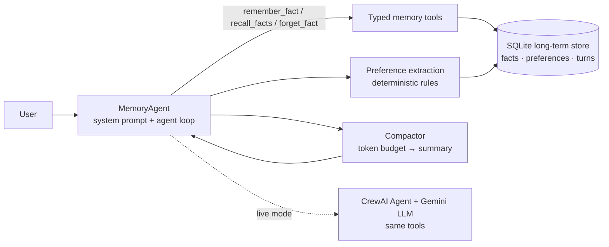

# agent-memory

A support agent that actually remembers.

## The pain

You contact support about a problem. The next day you follow up — and
the agent has never heard of you. You re-explain the whole issue, your
setup, and how you like to be contacted, every single time. And when a
conversation runs long, it blows past the context window mid-chat and
the agent forgets the beginning of the very conversation it is in.

This agent fixes both:

- **Session memory** — the current conversation, turn by turn.
- **Long-term memory** — facts about you in a persistent store that
  survives process restarts. Come back tomorrow; it still knows.
- **Learned preferences** — say "I prefer email over calls" once and
  it applies forever, in every later session.
- **Context compaction** — when the conversation outgrows its token
  budget, old turns fold into a compact summary that keeps the facts
  and preferences, so the agent keeps going instead of forgetting.

## Architecture



The system prompt holds behavior only ("check memory before making
the user repeat themselves"). Everything mechanical — preference
extraction rules, compaction triggers, storage — is deterministic
code.

## Quickstart

Mock mode is the default: **no API key, no network, stdlib only.**

```bash
python3 -m venv .venv && source .venv/bin/activate
pip install -e ".[dev]"

pytest            # run the test suite
agent-memory-demo # run the demo (or: python -m agent_memory.demo)
```

The demo runs two sessions with a simulated restart in between —
session 2 recalls the issue and both preferences without being
re-told — then a long conversation that triggers compaction and
keeps answering from memory.

### Live mode (optional)

```bash
pip install -e ".[live]"
export GEMINI_API_KEY=...   # your key, from the environment
```

Live mode builds a CrewAI agent (`build_crewai_agent`) with the same
three memory tools and a Gemini LLM. Everything else — store,
extraction, compaction — is identical.

## Why CrewAI

CrewAI is one of the few agent frameworks that treats memory as a
first-class concept: it ships short-term, long-term, and entity
memory primitives instead of leaving you to bolt on a vector store
yourself. That maps directly onto this project's shape — session
turns, durable user facts, learned preferences.

One honest caveat: CrewAI's built-in long-term memory embeds text
into a vector store, which needs a model call. Mock mode here must
run fully offline, so the memory layer is implemented locally
(SQLite) behind the same tool interfaces (`remember_fact`,
`recall_facts`, `forget_fact`). In live mode those exact tools are
handed to a CrewAI agent — the framework drives the conversation,
the store stays local and inspectable.

## What is real vs mocked

| Piece | Mock mode (default) | Live mode |
|---|---|---|
| Long-term store | Real — SQLite file, survives restarts | Same |
| Session memory | Real — turns persisted per session | Same |
| Preference extraction | Real — deterministic rules in code | Same |
| Compaction | Real trigger; summary built deterministically from stored facts/preferences + folded topics | Same |
| The "model" | Scripted: deterministic intent → tool calls → templated reply | CrewAI agent + Gemini |
| Agent loop | Real loop over the typed tools (bounded) | CrewAI's loop |

The mock model is deliberately dumb — it recognizes issue reports,
recall questions, and forget requests, and nothing more. That is the
point: everything this project is *about* (memory, preferences,
compaction) is real and tested offline; only the language
understanding is stubbed.

## Layout

```
src/agent_memory/
  agent.py        system prompt, agent loop, CrewAI live builder
  store.py        SQLite long-term memory (facts, preferences, turns)
  tools.py        typed remember/recall/forget tools
  preferences.py  deterministic preference extraction rules
  compaction.py   token budget + summary folding
  demo.py         the two-session + compaction demo
tests/            pytest suite (offline, no key)
```

## License

Apache-2.0 — see [LICENSE](LICENSE).
